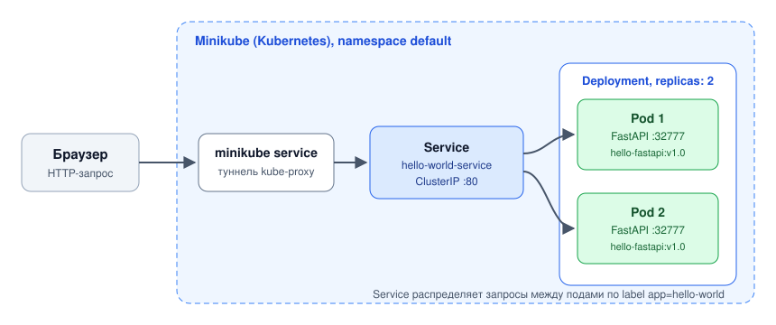

# Hello World в Kubernetes (Minikube)

[](https://github.com/RealPycuk/hello-world-minikube/actions/workflows/ci.yml)


Решение тестового задания на позицию стажёра DevOps-инженера: веб-приложение на FastAPI упаковано в Docker-образ и развёрнуто в локальном кластере Kubernetes (Minikube) в двух репликах за сервисом с балансировкой нагрузки.

## Схема



## Структура проекта

| Файл | Назначение |
|---|---|
| `app.py` | приложение на FastAPI, порт 32777; в ответе возвращает имя пода, который обработал запрос |
| `Dockerfile` | сборка образа с кэшированием слоя зависимостей, запуск не от root |
| `k8s-manifests.yaml` | Deployment на 2 реплики и Service типа ClusterIP |
| `.github/workflows/ci.yml` | автоматическая сборка, проверка манифестов и деплой в тестовый кластер |

## Ход выполнения

1. **Контейнеризация.** Сначала копируется `requirements.txt` и устанавливаются зависимости, затем код, поэтому при изменении кода зависимости не переустанавливаются. Образ опубликован на Docker Hub: `rusyajez/hello-fastapi:v1.0`.

2. **Запуск кластера** с docker-драйвером:
   ```bash
   minikube start --driver=docker
   ```

3. **Деплой манифестов:**
   ```bash
   kubectl apply -f k8s-manifests.yaml
   kubectl rollout status deployment/hello-world-deployment
   ```

4. **Проверка балансировки:**
   ```bash
   minikube service hello-world-service
   ```
   При повторных запросах поле `handled_by_pod` меняется между двумя подами, то есть Service распределяет трафик между репликами.

## Что настроено в манифестах

- **Readiness- и liveness-пробы:** трафик идёт только на готовые поды, зависший под перезапускается.
- **Requests и limits** по CPU и памяти: планировщик знает, сколько ресурсов нужно поду, а один под не может занять весь узел.
- **Безопасность:** запуск не от root, файловая система только для чтения, все Linux capabilities сброшены, повышение привилегий запрещено.

## CI

При каждом push GitHub Actions:

1. собирает Docker-образ и проверяет ответ контейнера;
2. проверяет манифесты по схемам Kubernetes (`kubeconform`);
3. поднимает кластер [kind](https://kind.sigs.k8s.io/), загружает в него образ и применяет манифесты;
4. ждёт успешного rollout и делает 30 запросов к Service изнутри кластера: тест проходит, только если ответили оба пода.
